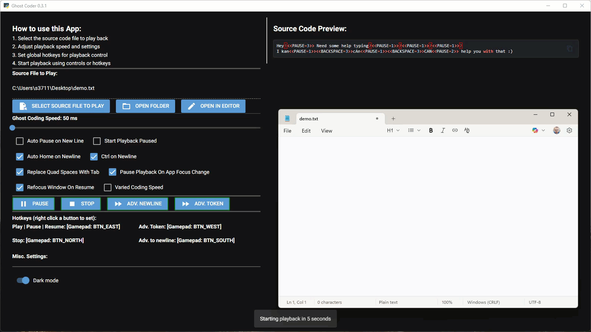

# Ghost Coder

**Automated code playback tool for creating coding tutorials and demo videos with hotkey-driven controls.**



## So what is it?!

Ghost Coder is a Windows application that loads a source file and "types" it into any editor or IDE, keystroke by keystroke, so it looks like you are coding live. Use it for tutorials, recorded demos or presentations without the stress (and typos) of live coding. Global hotkeys (keyboard, mouse or gamepad) let you pause, resume and step through the code while the editor stays in focus.

## Features

- **Automated typing playback** of any UTF-8 text/code file into the window you choose
- **Global hotkeys** for Play/Pause/Resume, Stop, Advance to Newline and Advance Token (keyboard, mouse buttons/scroll, gamepad buttons, D-pad and triggers)
- **Adjustable speed** (10–500 ms per keystroke) with optional random variation for natural-looking typing
- **Configurable start delay** (0–10 s) to click into your editor after pressing Play
- **Stepping**: pause on every new line, step one word/token at a time, or run to the end of the current line
- **Editor-friendly newlines**: Ctrl+Enter and auto-Home options to cooperate with IDE auto-indent and auto-closed brackets
- **Focus safety**: playback pauses automatically if another window takes focus, so keystrokes never land in the wrong app
- **Markers** in the source file for pauses, timed pauses, key presses, shortcuts and scrolling
- **Live progress** and status, source preview with syntax highlighting, dark mode
- Settings, hotkeys and last file are remembered between sessions

## Installation

### Windows installer (recommended)

Download `GhostCoder-Setup-<version>.exe` from the [releases](https://github.com/sethstenzel/ghost-coder/releases) and run it. It installs per-user (no admin rights needed) to `%LOCALAPPDATA%\Programs\Ghost Coder` and adds a Start Menu shortcut.

Requires the Microsoft Edge WebView2 runtime (pre-installed on Windows 11 and up-to-date Windows 10).

### From PyPI (coming soon)

```bash
pip install ghost-coder
ghost-coder
```

### From source

```bash
git clone https://github.com/sethstenzel/ghost-coder.git
cd ghost-coder
uv sync
uv run ghost-coder
```

## Usage

1. Click **Select File** and choose the source file to play back.
2. Adjust speed and options.
3. Right-click any control button to assign a global hotkey.
4. Press **Play** (or your hotkey), then click into your editor before the countdown ends. The window that has focus when the countdown finishes becomes the target.
5. Use Pause/Resume, Advance Newline and Advance Token to control the pace.

Tip: with a hotkey you can start playback while your editor already has focus. Set the start delay to 0 for an instant start.

### Controls

| Control | Behaviour |
| --- | --- |
| **Play / Pause / Resume** | Starts playback (after the start delay), pauses it, or resumes it. |
| **Stop** | Stops playback. The next Play starts from the top of the file and re-reads it from disk. |
| **Advance Newline** | While paused: types up to and including the next line break, then pauses again. While playing: pauses at the end of the current line. |
| **Advance Token** | While paused: types the next word (or marker) and pauses again. |

### Hotkeys

Right-click a control button and choose Keyboard, Mouse or Gamepad, then press the input you want to use. ESC cancels registration, which also times out after 15 s.

- Keyboard: any key (function keys such as F9 work well).
- Mouse: right, middle and side buttons or scroll directions. The left button is not allowed.
- Gamepad: buttons, D-pad directions and analog triggers. Analog sticks are ignored.

Each input can only be bound to one control. Keystrokes produced by Ghost Coder itself never trigger hotkeys. A saved gamepad hotkey whose controller is not connected is kept and shown as inactive.

### Options

| Option | Description |
| --- | --- |
| Typing speed | Delay per keystroke (10–500 ms). |
| Start delay | Countdown after pressing Play before the target window is captured (0–10 s). |
| Varied typing speed | Adds random jitter (-50 ms to +150 ms) to every keystroke. |
| Start playback paused | Captures the target window, then waits for Resume or Advance. |
| Auto pause on new line | Pauses after every line break. |
| Replace leading 4 spaces with Tab | Types indentation as Tab keys so the editor applies its own indent style. Only leading indentation is converted. |
| Auto Home on new line | Presses Home after each line break, so the file's own indentation is typed from column 0 instead of after the editor's auto-indent. |
| Ctrl+Enter for new lines | Uses Ctrl+Enter ("insert line below" in VS Code and most IDEs), so auto-closed brackets and quotes are not pushed onto the next line. |
| Pause when target loses focus | Pauses if another window becomes active. When off, Ghost Coder takes focus back before typing. |
| Refocus target on resume | Brings the target window to the front when resuming, for example after clicking Resume in Ghost Coder. |

## Markers

Put markers in the source file to control playback. Markers are case-insensitive; counts use `=` or `:` (`<<DOWN=3>>` or `<<DOWN:3>>`).

| Marker | Action |
| --- | --- |
| `<<PAUSE>>` | Pause playback here (resume with your hotkey). |
| `<<PAUSE=1.5>>` | Wait 1.5 seconds, then continue. |
| `<<ENTER>>`, `<<TAB>>`, `<<SPACE>>`, `<<ESC>>` | Press the key (a plain Enter, without the newline options). |
| `<<BACKSPACE=3>>`, `<<DELETE>>`, `<<INSERT>>` | Editing keys, optionally repeated. |
| `<<UP>>` `<<DOWN=10>>` `<<LEFT>>` `<<RIGHT>>` | Arrow keys (`UP_ARROW` and similar also work). |
| `<<HOME>>`, `<<END>>`, `<<PAGEUP>>`, `<<PAGEDOWN>>`, `<<F1>>`…`<<F20>>` | Navigation and function keys. |
| `<<CTRL+S>>`, `<<CTRL+SHIFT+P>>`, `<<ALT+TAB>>`, `<<WIN+E>>` | Key combinations (modifiers: CTRL, ALT, SHIFT, WIN). |
| `<<SCROLLUP=5>>`, `<<SCROLLDOWN=3>>` | Scroll the mouse wheel. |

Anything that looks like a marker but isn't a valid one is typed literally, so code like `cout << x;` or `a<<b>>c` plays back correctly.

## Command-line options

```text
ghost-coder [--port PORT] [--logging] [--extbroker HOST:PORT] [--version]
```

- `--port`: port for the internal MQTT broker (default: a random free port).
- `--logging`: write debug logs to `%LOCALAPPDATA%\GhostCoder\logs\ghost_coder.log` and the console.
- `--extbroker` / `--extmqtt`: use an external MQTT broker instead of the built-in one.

## Files

| Path | Contents |
| --- | --- |
| `%APPDATA%\GhostCoder\settings.json` | Options, dark mode and last opened file |
| `%APPDATA%\GhostCoder\hotkeys.json` | Hotkey assignments |
| `%LOCALAPPDATA%\GhostCoder\logs\ghost_coder.log` | Log file (only with `--logging`) |

## Architecture

Ghost Coder runs four processes that talk over MQTT:

- **UI** (`app.py`): NiceGUI native window. Sends commands and mirrors playback status.
- **Broker** (`broker.py`): embedded amqtt broker on `127.0.0.1` (skipped with `--extbroker`).
- **Listener** (`listener.py`): global keyboard/mouse/gamepad hooks for hotkey recording and triggering.
- **Typer** (`typer.py`): parses the file and sends keystrokes to the target window. It is the single source of truth for playback status.

| Topic | Messages |
| --- | --- |
| `TYPER` | UI → typer commands: `load_file`, `play`, `pause`, `resume`, `stop`, `advance_newline`, `advance_token` |
| `STATE` | UI → typer settings (`state-data`); typer → UI `play_status` updates |
| `UI` | typer → UI notifications, progress, countdown and target window |
| `LISTENER` | UI → listener `register` / `restore` / `unregister` / `cancel`; listener → UI hotkey events |
| `APP` | `CLOSE` shuts every process down |

Child processes exit on their own if the UI process dies.

## Development

```bash
uv sync --all-groups          # runtime, dev and build dependencies
uv run pytest                 # unit tests
uv run python -m ghost_coder --logging
```

### Project structure

```text
ghost-coder/
├── src/ghost_coder/
│   ├── app.py          # UI process and process management
│   ├── typer.py        # playback engine
│   ├── listener.py     # global hotkey listener
│   ├── broker.py       # embedded MQTT broker
│   ├── data.py         # source parser (text and markers -> tokens)
│   ├── winutil.py      # Win32 focus helpers
│   ├── utils.py        # paths, logging, ports
│   └── assets/icon.ico
├── packaging/
│   ├── build.ps1       # wheel + Nuitka exe + NSIS installer
│   ├── installer.nsi   # NSIS installer script
│   ├── launcher.py     # Nuitka entry script
│   └── run-dev.bat     # launch from the dev venv without a console
└── tests/
```

### Building the app and installer

Requirements: [uv](https://docs.astral.sh/uv/), Visual Studio 2022 Build Tools (MSVC) and [NSIS](https://nsis.sourceforge.io/).

```powershell
./packaging/build.ps1             # dist/*.whl, build/nuitka/GhostCoder/GhostCoder.exe, dist/GhostCoder-Setup-<version>.exe
./packaging/build.ps1 -Install    # also installs the result silently
```

Bump the version with `uvx bump-my-version bump patch|minor|major`.

## License

MIT License. See [LICENSE](LICENSE).

## Author

**Seth Stenzel** - [seth.c.stenzel@gmail.com](mailto:seth.c.stenzel@gmail.com)

## Links

- **Homepage / Repository**: [https://github.com/sethstenzel/ghost-coder](https://github.com/sethstenzel/ghost-coder)
- **Issues**: [https://github.com/sethstenzel/ghost-coder/issues](https://github.com/sethstenzel/ghost-coder/issues)

## Acknowledgments

Built with [NiceGUI](https://nicegui.io/), [pywebview](https://pywebview.flowrl.com/), [pynput](https://pynput.readthedocs.io/), [inputs](https://inputs.readthedocs.io/), [Eclipse Paho](https://www.eclipse.org/paho/) and [amqtt](https://github.com/Yakifo/amqtt).
